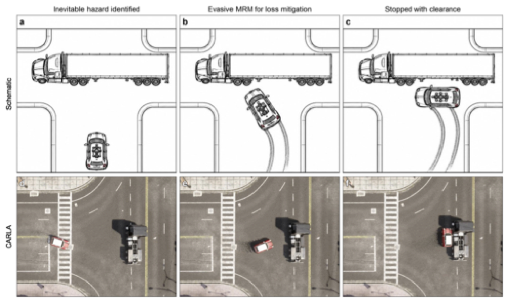

# EMRM V&V Framework: HARA–STPA–FSM Scenario Validation

This repository contains the simulation code, scenario definitions, and generated
results supporting the paper:

> A. Arab, M. Khaleghi, K. Aslansefat, Y. Mousavi, and A. Abbaspour,
> "Safety Verification of Aggressive Minimum Risk Maneuvers using High-Resolution
> Assessments for Autonomous Cars."

It implements the integrated Hazard Analysis and Risk Assessment (HARA),
System-Theoretic Process Analysis (STPA), and Finite State Machine (FSM)
verification-and-validation pipeline for the Evasive Minimum Risk Maneuver (EMRM)
feature, applied to a T-junction case study. The code reproduces the RRT-based
scenario coverage, the mitigability mapping over the (ego speed, time-to-collision,
road friction) parameter space, and the EMRM-vs-emergency-braking comparison
reported in the article.

<p align="center">
  
</p>

*T-junction scenario with a truck blocking the road: concept schematic (top) and the
same scenario illustrated in the CARLA driving simulator (bottom), from hazard
identification through the evasive MRM to a stop with clearance. The CARLA scenes are
illustrations; all reported results come from the vehicle model and planner in this
repository.*

<table>
  <tr>
    <td align="center" width="50%">
      <a href="media/emrm_carla_driver_view.mp4"></a>
      <br><sub>Driver view</sub>
    </td>
    <td align="center" width="50%">
      <a href="media/emrm_carla_topview.mp4"></a>
      <br><sub>Top view</sub>
    </td>
  </tr>
</table>

*Evasive MRM at the T-junction simulated in CARLA. Click a clip for the full-resolution video.*

## Repository layout

```
framework/            Scenario definition and map/region abstractions
  scenario_def.py     Scenario schema and loading
  map_region.py       Occupancy-map / region handling
maps/                 T-junction occupancy maps (PNG + PGM) and description
scenarios/            Scenario YAML definitions (EMRM Scene 1, T-junction)
ru_racer_dynamics.py  Bicycle vehicle dynamics (Pacejka tire, slip-based forces)
run_rrt_tjunction.py  RRT planner on the T-junction map (tree + best path)
run_coverage_test.py  Coarse parameter-space coverage sweep
run_coverage_fine.py  Fine-grid coverage sweep (speed x TTC)
run_friction_sweeps.py Friction / speed / TTC sweeps
run_validation_scenarios.py  EMRM vs emergency-braking validation
run_sim_brake.py      Emergency-braking baseline simulated with the RRT plant
run_seed_campaign.py  Seed replication and TTC boundary refinement (Wilson intervals)
run_uca4_truncation.py  UCA4 test: EMRM avoidance path terminated prematurely
run_straight_road.py  Additional scenario: straight road with a stalled vehicle
audit_revision.py     Recomputes every reported count and metric from results/
revision_tables.py    Reproduces Tables 10, 11, and 13 and the worst-case baseline points
plot_revision_figs.py Outcome maps and parameter-sweep figures of the revision
render_fig8.py        Composite of the 12 canonical RRT scenarios (Fig. 8)
plot_trajectories_on_map.py  Trajectory plotting utilities
fix_start_area.py     Map start-area preparation helper
results/              Generated CSV results and demo trajectories
media/                Scenario figure and CARLA videos shown in this README
```

## Requirements

Python 3.8+ and the packages listed in `requirements.txt`:

```
pip install -r requirements.txt
```

## Reproducing the results

```bash
# RRT planning on the T-junction map
python run_rrt_tjunction.py

# Fine-grid parameter-space coverage (ego speed x TTC)
python run_coverage_fine.py

# Friction / speed / TTC sweeps
python run_friction_sweeps.py

# EMRM vs emergency-braking validation
python run_validation_scenarios.py

# Simulated emergency-braking baseline
python run_sim_brake.py

# Seed replication and boundary refinement
python run_seed_campaign.py

# UCA4 (premature termination) test
python run_uca4_truncation.py

# Additional straight-road scenario
python run_straight_road.py

# Recompute all reported numbers from the CSV results (no simulation)
python audit_revision.py
python revision_tables.py

# Figures of the revised manuscript
python plot_revision_figs.py
python render_fig8.py
```

Generated CSV outputs are written under `results/` and match the figures and
tables reported in the paper (coverage maps, mitigability regions, and the
EMRM-vs-baseline comparison).

## Data

All data in this repository are generated by analytical model-based simulation.
No human participants, human data, or animals are involved.

## License

Released under the MIT License. See `LICENSE`.
